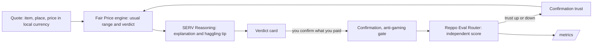

# Fair Price

A fair price check for anything, anywhere. Pick your country, type what you are buying, where, and the price you were quoted (or snap the price tag). Fair Price returns the usual range in your own currency, a verdict (fair, too high, suspiciously low, or not sure yet), short reasons, and a haggling tip. Confirmed payments feed back into the price book, so later checks nearby get measurably better.

Live at https://fairprice-global.vercel.app and on Telegram as [@FairpriceSERV_bot](https://t.me/FairpriceSERV_bot).

Built for SERV Hackathon 02, Reppo track.

## How it works

Three parts, each with one job:

1. **Fair Price engine (our code)** computes the usual range from cited public prices for the country, region or city, plus payments people nearby confirmed. It decides the verdict. It never mixes currencies.
2. **SERV Reasoning (OpenServ)** reads the quote against that range and the local data, explains the verdict in plain words, and writes the haggling tip. With no local data it gives a rough guess, shown as "Not sure yet, be the first to confirm".
3. **Reppo Eval Router** independently scores each confirmed check. The score feeds back into trust: a high score raises how much that confirmation counts, a low score or a rejection cuts it. Scores and accuracy are on `/metrics`.



Plain-text version:

```
 quote (item, place, price, currency)
        |
        v
 [Fair Price engine] -- range + verdict --> [SERV Reasoning] -- why + tip --> verdict card
        ^                                                                       |
        |                                                          you confirm what you paid
        |                                                                       v
 [trust per confirmation] <-- score 85+ boosts, <60 or reject cuts -- [Reppo Eval Router]
                                                                                |
                                                                            /metrics
```

Details:

- **Engine.** Weighted-median range from dated public anchors plus accepted confirmations, all in one currency. Fallback stays inside the country: city, then region, then the whole country, then "not sure yet". 15% fair band, outlier quarantine, a 24-hour same-device duplicate window, and device trust that grows with accepted confirmations and drops with quarantined ones.
- **SERV Reasoning** (`gpt-5.4-mini`, `inference-api.openserv.ai`) gets a sanitized evidence pack that states the currency and never converts it. The engine's range is authoritative: the label always follows where the quote sits in it, so the stamp, range bar, and text agree. If SERV's verdict differs, its reasons and tip are dropped and any specific reason it gives is shown as "Ada's note". If SERV is down, the UI shows the range and says so.
- **Reppo Eval Router** (`https://eval.reppo.xyz/api/v1/agents/evals`). When someone confirms what they paid on a live check, the evidence pack, the verdict, and the paid amount go to Reppo as one `claim` eval. Status refreshes lazily when the check is read, so it works on serverless. On completion, a score of 85 or more multiplies that confirmation's trust by 1.15 (capped at 1.2); a rejection or a score under 60 halves it (floor 0.05). Each eval is applied once and recorded as boosted, unchanged, or reduced.
- **Anything, anywhere.** Every ISO country and currency is supported, with `Intl.NumberFormat` money formatting and local units (pounds and US gallons in the US, kilograms and litres elsewhere). Items and places are free text: a new item or town gets its own key, starts as "not sure yet", and builds a range from confirmations.
- **Photo reader** runs in the browser with tesseract.js after a greyscale and contrast pass. Photos are never uploaded. It reads currency marks such as ₦, $, £, €, ₹, KSh and R$, skips pack sizes such as 75cl, and always asks you to check the number.
- **Telegram bot** uses buttons, not slash commands: Check a price, Price board, How it works, Change country, and Accuracy. It asks for your country once (or reads it from your Telegram language when it has a region), then guides you through the item, unit, place and price. The verdict has I paid this, Looks fair and Looks off. How it works, the board and Accuracy include a short summary and a link to the web page. Slash commands still work as hidden fallbacks; the bot menu only lists `/start`.
- **Abuse limits**: 30 checks and 20 confirmations per 10 minutes per IP and device, per instance.

## Countries with starter data

| Country | Currency | Starter figures (cited in `data/seed.json`) |
| --- | --- | --- |
| Nigeria | NGN | NBS Selected Food, PMS, Transport Fare and LPG price watches (national, zone and state averages) |
| United States | USD | BLS Average Price Data, September 2026 (gasoline, eggs, bread, milk, tomatoes, chicken) |
| United Kingdom | GBP | RAC Fuel Watch, findpetrol regional index, ONS shopping prices (September 2026) |
| India | INR | City petrol prices (IOCL, 12 Nov 2026) and 14.2 kg LPG for six metros |
| Kenya | KES | KNBS October 2026 average prices and EPRA city pump maximums |
| Brazil | BRL | ANP October 2026 monthly and week-43 capital-city petrol, GLP P-13 |

Every other country works with free-text items and confirmations, and SERV's rough guess until local prices arrive. Starter figures are national, regional or city averages, not live stall or pump prices.

## Local run

Keys live in a `chmod 600` `.env` (gitignored). Copy `.env.example` and fill in what you have.

```bash
cd fair-price
npm install
npm test
npm run dev
```

Then open http://127.0.0.1:5173. The Vite dev server proxies `/api` to the API on http://127.0.0.1:3001.

- Production-style serve after a build: `npm run build && npm start` (API and app on http://127.0.0.1:3001)
- Telegram long-poll (no public webhook needed): with the API running, `npm run dev:bot`, then open [@FairpriceSERV_bot](https://t.me/FairpriceSERV_bot) and tap Start

Demo mode (header switch, or `?demo=1`) uses seeded data and saved Reppo evals. It never calls SERV or Reppo and never mixes with live data. Add `?country=KE` (any ISO code) to open in a given country; otherwise the app guesses from your time zone and browser language, and remembers your pick.

## Environment

| Variable | Purpose |
| --- | --- |
| `OPENSERV_API_KEY` | SERV Reasoning. Without it the code band is shown and the UI says the judgment service is off. |
| `REPPO_API_KEY` | Reppo Eval Router. Without it confirmations are still saved, just not scored. |
| `REPPO_DAILY_EVAL_CAP` | Rolling 24-hour cap on live evals (default 10, about 440 credits each). |
| `FAIRPRICE_TELEGRAM_BOT_TOKEN` | Telegram bot. |
| `TELEGRAM_WEBHOOK_SECRET` | If set, `/api/telegram` requires the matching `X-Telegram-Bot-Api-Secret-Token` header. |
| `DATABASE_URL` or `POSTGRES_URL` | Postgres connection string. Takes priority over PGlite. Pooler URLs work (prepared statements are off). |
| `PGLITE_DIR` | Local PGlite directory (default `data/.pglite`, gitignored). |
| `FAIRPRICE_STORE=memory` | Force an in-memory PGlite store (tests use this). |
| `SERV_TIMEOUT_MS` | SERV request timeout (default 30000). |

## Environment

| Variable | Purpose |
| --- | --- |
| `OPENSERV_API_KEY` | SERV Reasoning. Without it the code band is shown and the UI says the judgment service is off. |
| `REPPO_API_KEY` | Reppo Eval Router. Without it confirmations are still saved, just not scored. |
| `REPPO_DAILY_EVAL_CAP` | Rolling 24-hour cap on live evals (default 10, about 440 credits each). |
| `FAIRPRICE_TELEGRAM_BOT_TOKEN` | Telegram bot. |
| `TELEGRAM_WEBHOOK_SECRET` | If set, `/api/telegram` requires the matching `X-Telegram-Bot-Api-Secret-Token` header. |
| `DATABASE_URL` or `POSTGRES_URL` | Postgres connection string. Takes priority over PGlite. Pooler URLs work (prepared statements are off). |
| `PGLITE_DIR` | Local PGlite directory (default `data/.pglite`, gitignored). |
| `FAIRPRICE_STORE=memory` | Force an in-memory PGlite store (tests use this). |
| `SERV_TIMEOUT_MS` | SERV request timeout (default 30000). |

## Database

All runtime state lives in SQL: checks (`verdicts`), confirmed prices (`observations`), feedback, 24-hour device duplicate keys (`device_keys`), device trust counters (`devices`), Reppo eval records (`reppo_evals`), and Telegram chat sessions (`tg_sessions`).

- **Postgres** when `DATABASE_URL` or `POSTGRES_URL` is set (any hosted Postgres, for example Neon or Supabase). Nothing is provisioned by this repo.
- **PGlite** (embedded Postgres in WebAssembly) otherwise, stored in `data/.pglite`. On Vercel without a database URL it falls back to memory, and `/api/health` reports `durable: false`.
- **Migrations** are append-only entries in `server/db/migrations.ts`, applied on first connection and recorded in `schema_migrations`. Never edit an applied migration; add a new one. `002_global_currency` renames the naira columns to `quote`, `price` and `paid`, adds `currency` and `country` (existing rows default to NGN and NG), adds item names, units and verdict links to observations, and adds `trust_effect` to Reppo evals.
- The duplicate check is a single atomic `INSERT … ON CONFLICT … WHERE` so two fast confirmations from one device cannot both count.
- `npm run db:inspect` prints row counts and the latest evals (stop the server first when using PGlite, which is single-process).

## Benchmark

`data/benchmark.json` has 116 price cases in six countries, each tied to a cited source. A case is labelled fair when the quote is within 15% of the cited reference. Cases are split by a hash of their ID into dev (33) and a held-out test split (83); engine settings were not tuned on either split. Rebuild with `npm run bench`.

Cases are either **control** (the reference is the same figure the seed holds, so they test only the range maths and fallback) or **cross-source** (the reference comes from a different publication, a fresher report, or a town with no seed figure).

"After feedback" replays a simulated confirmation stream (seeded, with scatter, a small upward bias, 30% wild outliers, and 30% duplicates) through the same anti-gaming gate the app uses.

| Split | Seed only | After feedback |
| --- | --- | --- |
| Test (83) | 65.1% (54/83) | 89.2% (74/83) |
| Dev (33) | 60.6% (20/33) | 87.9% (29/33) |
| All (116) | 63.8% (74/116) | 88.8% (103/116) |

Per country (all cases):

| Country | Cases | Control / cross-source | Seed only | After feedback |
| --- | --- | --- | --- | --- |
| Nigeria (NGN) | 73 | 28 / 45 | 49.3% | 83.6% |
| United Kingdom (GBP) | 11 | 8 / 3 | 100% | 100% |
| United States (USD) | 7 | 7 / 0 | 100% | 100% |
| Kenya (KES) | 9 | 3 / 6 | 100% | 100% |
| India (INR) | 9 | 4 / 5 | 44.4% | 88.9% |
| Brazil (BRL) | 7 | 4 / 3 | 100% | 100% |

Honest limits: Nigeria's 73 cases and numbers are unchanged from the Nigeria-only version. Outside Nigeria most cases are controls or close anchors (for example Kenyan towns whose EPRA maximum sits within 1 to 6 percent of the national average), so those 100% scores are a sanity check, not proof. India shows the real gap: towns with no seed figure start at "not sure yet" until confirmations arrive. The simulated confirmations are drawn around the same references used for the labels, so the after-feedback number shows the loop works, not real-world accuracy. The benchmark measures the engine; SERV's wording is not scored here. Reppo scores live checks separately.

## Checks you can run

- `npm test`: engine, API, database, benchmark, SERV client, OCR parser, and Telegram handler tests (in-memory store, no keys)
- `npm run e2e:live`: one live check through SERV, one paid confirmation to Reppo (spends one eval), polls it, and writes `reports/e2e-live.json`
- `npm run e2e:telegram`: `getMe` on the bot token, then synthetic updates through the webhook route with a captured sender (nobody is messaged)
- `npm run telegram:transcript`: runs the real handler on a synthetic conversation and writes `reports/telegram-transcript.json` for the demo video
- `npm run telegram:configure`: sets the bot menu, descriptions and webhook `allowed_updates` (prints no secrets)
- `npm run ocr:check`: runs the in-browser photo reader in headless Chrome on the tag photos in `tests/fixtures`
- `npm run shots`: refreshes `shots/` in demo mode, at 390 and 360 px phone widths and 1440 and 1280 px desktop widths

## Seed data

`data/seed.json` holds small, attributed transcriptions of published figures, each with its source URL and period: Nigeria's National Bureau of Statistics price watches, US BLS average prices, UK ONS shopping prices, RAC and findpetrol fuel figures, KNBS and EPRA in Kenya, ANP in Brazil, and dated city fuel and LPG prices in India. NBS terms (https://www.nigerianstat.gov.ng/page/terms) do not allow redistributing the raw workbooks; those files are not in this repository. Figures are averages, not live stall or pump prices, and are labelled that way in the product.

## Deploy notes

Production runs on Vercel (project `fair-price`, functions in `iad1`) with a free Neon Postgres database from the Vercel Marketplace, which sets `DATABASE_URL` and `POSTGRES_URL`. Vite builds the app to `dist/public`; `api/index.ts` serves `/api/*`; `vercel.json` has the SPA fallback. Migrations run on the first database connection; `npm run db:migrate` applies them by hand.

The production domain is `fairprice-global.vercel.app`; the earlier `fairprice-ng.vercel.app` permanently redirects (308) to it. The Telegram bot uses a webhook at `https://fairprice-global.vercel.app/api/telegram` with `TELEGRAM_WEBHOOK_SECRET`. While the webhook is set, `npm run dev:bot` (long-poll) will not receive updates; delete the webhook first if you need local polling.

`npm run smoke:prod` loads the home page, runs demo checks in headless Chrome at 360 and 1440 px, runs one live check without confirming (no Reppo spend), and saves the screenshots.

Do not commit `.env`. Do not put NBS raw files in the repo.
